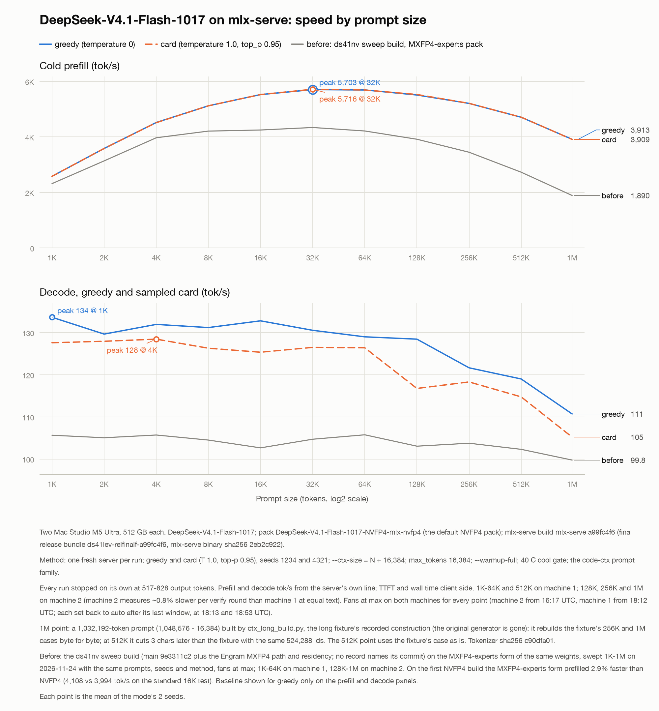
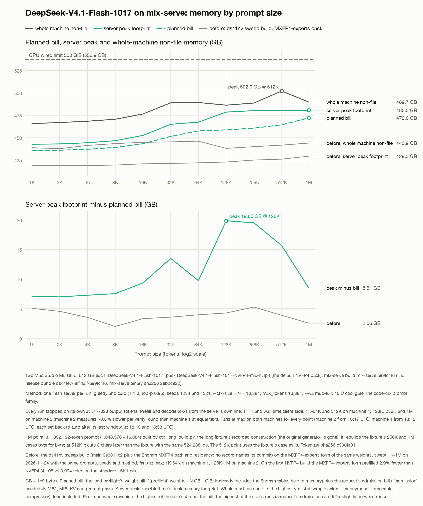

# PR #1256 results record

The results record of PR #1256 (ddalcu/mlx-serve) at `d9f97e0f`, branch `nvfp4-ds41-ab` on davidtai/mlx-serve. "We" are the authors of the `deepseek_v41` plugin. The PR body gives the summary; this page holds the run tables, the history and the smaller gaps. The PR body's Conventions apply here: Mac 1 and Mac 2 are two M5 Ultra Macs with 512 GiB, GB means 1e9 bytes, and switch names omit `MLX_SERVE_DSV41_`.

## NVFP4 pack in core

The 47 changes are 44 plugin-switch A/Bs, 2 DSpark policy A/Bs and `FLASH_ATTN`, which existed before and now serves every pack. They add 46 plugin switches and 2 engine switches. Two A/Bs each added a pair of switches: `ENGRAM_KV_SLOTS` with `ENGRAM_KV_CACHE`, and `DRAFT_VOCAB` with `DRAFT_VOCAB_PROMPT`.

Greedy text can still change under REORDER and DRAFT-ONLY. No test compares the whole model with a reference implementation. Two switches, both on in `main`, are outside the classes: the 8-bit LM head (`HEAD8`) and a lossy f16 attention core (`ATTN_F16`). `ATTN_F16` is now on by default only without NAX.

### Baselines, standard-test cells and p10

| Baseline | Build | Compared on |
|---|---|---|
| The first NVFP4 build | `f7e4da9e`, an early build of this branch (2026-11-20), before the fused fp4 decode was on by default; its A/B `nvpf-dsproof-ab` ran both packs | Speed, the pack's memory |
| The ds41nv sweep build | The stack at the start of this work (2026-11-20): by its run notes, `main` `9e3311c2` plus the Engram mxfp4 path and its residency, on the MXFP4 pack with no quant plugin. We swept it again, 1K to 1M, on 2026-11-24. Its binary's sha256 starts `534d15b3`; the records name no commit | The sweep |
| The last reviewed head | `58279979`, NVFP4 | What the 47 changes give, and their memory cost |
| The control | `04b8f7d0`: the 47 changes, before the upstream merge and the release audit's fixes (tests, the load scan and the attention-core fix) | p10 |

From `58279979` (Mac 1) to the release (Mac 2): +38.4% prefill and +19.1% decode; Mac 2 runs about 0.8% slower per round. On `f7e4da9e` the MXFP4 pack ran 4,108.3 / 73.83; NVFP4 was 2.8% slower.

The release's standard-test cells on Mac 2 are three-prompt means (p01, p14, p21); the p10 row is one prompt, 2 runs.

| Cell | Prefill tok/s | Decode tok/s | Tokens per round |
|---|---|---|---|
| Greedy, DSpark on | 5,526.4 | 97.98 | 2.99 |
| The card's sampling settings, DSpark on | 5,535.4 | 88.05 | 2.70 |
| Greedy, DSpark off | 5,546.6 | 61.33 | - |
| p10, greedy, DSpark on | 5,524.5 | 98.50 | 2.94 |

p10 is a fourth library prompt, not part of the standard test. On it the release (Mac 2) decodes 7.5% slower than the control (Mac 1): 98.50 against 106.45 tok/s. The attention-core fix (`4452a4bd`, which gave the prompt-attention core one owner, `attnCore`) changed the text, and acceptance fell from 3.51 to 2.94 tokens per round. Whole-decode ms per round fell from 33.6 to 30.5, so round time did not rise.

| Build | Benchmark | Base pass@1 | Plus pass@1 |
|---|---|---|---|
| `a99fc4f6` | HumanEval, 164 tasks | 161/164 (98.2%) | 154/164 (93.9%) |
| `a99fc4f6` | MBPP, 378 tasks | 366/378 (96.8%) | 313/378 (82.8%) |

EvalPlus ran with seed 1234, the template's default effort ("high"), max_tokens 16,384, `--ctx-size 32768`, DSpark on and `--warmup-full`. The HumanEval ceiling is 163: HumanEval/32's canonical solution fails under EvalPlus.

### Memory

| Step | Build | p01 peak |
|---|---|---|
| The first NVFP4 build, the MXFP4 pack | `f7e4da9e` | 420.7 GB |
| The first NVFP4 build, the NVFP4 pack | `f7e4da9e` | 438.6 GB |
| The last reviewed head, NVFP4 | `58279979` | 438.6 GB |
| The release, NVFP4 | `a99fc4f6` | 452.0 GB |

The pack adds 17.9 GB, because NVFP4's 16-value groups carry more scale bytes. The code adds 13.4 GB. Six changes moved the peak by more than 0.5 GB: `PF_KEEP_WIDE` +7.3 GB, `ENGRAM_KV_CACHE` +4.0, `PF_PASS_SIZE` +3.9, `MOE_PAIR_SCALED` (now `MOE_PAIR_FP4`) -1.4, `PF_COMP_BF16` -0.7 and `FLASH_ATTN` -0.7. The three that add memory trade it for speed: `PF_PASS_SIZE` +7.96% prefill, `PF_KEEP_WIDE` +2.19% prefill, the Engram slot kernel and partials cache +0.28% decode.

At 1M the whole machine's non-file memory peaked at 489.7 GB (502.0 GB at most over the sweep), with 0 pageouts. Admission had a 39.0 GB margin at 1M (36,087 MiB needed, 73,320 MiB available) at 512000 MiB. At macOS's default wired limit the 1M point is untested.

### Accuracy classes

| Group | Switches | EXACT | REORDER | DRAFT-ONLY | TF32 | Outside |
|---|---|---|---|---|---|---|
| New plugin switches since `58279979` | 46 | 28 | 12 | 6 | 0 | 0 |
| Plugin switches on at `58279979` (`CED`, `FLASH_ATTN`, `FP8_FOLD`, `MOE_FP4_NAX`, `HEAD8`, `ATTN_F16`) | 6 | 1 | 3 | 0 | 0 | 2 |
| All default-on plugin switches at the release | 52 | 29 | 15 | 6 | 0 | 2 |
| Engine: `DSV4_DSPARK`; `DSPARK_POLICY2`, `DSPARK_POLICY2_MODELED`; MLX's own `MLX_ENABLE_TF32` | 4 | 0 | 1 | 2 | 1 | 0 |

The fold adds 5 default-on switches (#1317's four and `PF_PASS_CEIL`), and renames `MOE_PAIR_SCALED` to `MOE_PAIR_FP4`. The README's switch table at the fold head lists 57 default-on, 55 classed (32 EXACT, 17 REORDER, 6 DRAFT-ONLY) and 49 with a standing test. The REORDER evidence splits 6 measured no farther from float64, 7 held to a stated bound, 2 by the commit's reasoning and 2 by the A/B's same text.

6 of the 55 have no standing test against their `=0` path: `WOA_JOIN`, `DRAFT_POS_ONCE` (EXACT); `CED`, `PF_PASS_SIZE`, `HC_EXPAND_NORM` (REORDER); and `SPEC_SYNC` (DRAFT-ONLY). TF32 is its own class, for MLX's own `MLX_ENABLE_TF32`: on M5 at the defaults, its TF32 matmuls round only the drafter's P·V. `FLASH_ATTN` passes: its output is nearer to float64 than the gather's. `ATTN_F16` fails: at the release's prompt spans on M5, its bf16-out l2 against float64 was 1.80e-3 to 2.31e-3, against 1.63e-3 to 1.68e-3 for the f32 chain.

### Release sweep

The release ran prompts from 1K to 1M tokens, greedy and with the card's settings, two seeds each. The 1M point is a 1,032,192-token prompt, so prompt + 16,384 is the model's 1,048,576 window. The table shows 6 of the 11 sizes, greedy means; reply comment 5 has all 11 and the card's runs.

| Context | Prefill tok/s | Decode tok/s | TTFT s | Server peak GB | Before: prefill / decode / TTFT s | Prefill, release / before | Decode, release / before |
|---|---|---|---|---|---|---|---|
| 1K | 2,580.3 | 133.65 | 0.40 | 442.6 | 2,316.6 / 105.65 / 0.45 | x1.11 | x1.27 |
| 16K | 5,524.1 | 132.80 | 2.98 | 452.5 | 4,248.0 / 102.65 / 3.87 | x1.30 | x1.29 |
| 128K | 5,508.9 | 128.45 | 23.85 | 478.3 | 3,915.8 / 103.05 / 33.53 | x1.41 | x1.25 |
| 256K | 5,206.5 | 121.65 | 50.46 | 479.4 | 3,447.5 / 103.75 / 76.15 | x1.51 | x1.17 |
| 512K | 4,707.5 | 119.00 | 111.57 | 480.0 | 2,728.6 / 102.30 / 192.35 | x1.73 | x1.16 |
| 1M | 3,912.9 | 110.70 | 264.18 | 480.5 | 1,889.5 / 99.75 / 546.66 | x2.07 | x1.11 |

Before is the ds41nv sweep build on the MXFP4 pack. We swept it on 2026-11-24 with the same prompts, seeds and method, fans at max: 1K to 64K on Mac 1 and 128K to 1M on Mac 2. The release's 512K point ran on Mac 1; the sources do not record the Mac of its other points. The sweep's prompts reach 4.4 to 4.9 tokens per round, against 2.99 on the standard test, so do not compare sweep decode with standard-test decode.

## Prompt-pass switches

| Switch | Change | Class | A/B | Prefill B - A |
|---|---|---|---|---|
| `PF_COMP_PASS` | A KV source layer's compressor pools, norms and ropes every span's rows in one pass, in about 15 launches a layer, not about 1,000 | EXACT | `rs-compass` | +15.2 (+0.27%), 3 of 3 prompts, same text |
| `PF_IDX_PASS` | An index layer computes its indexer queries and head weights once over the pass, not per span, on a new kernel (`kernels/idx_wproj.metal`) | REORDER, measured no farther from float64 | `rs-idxpass` | +14.6 (+0.26%), 3 of 3 prompts, text differs |
| `PF_DOWN_BK32` | The staged fp4 down of a prompt MoE call with 96 or more routed rows an expert runs 32 deep a step on its 64 x 64 tile, not 64 | EXACT | `rs-downbk32` | +4.7 (+0.08%), 3 of 3 prompts, same text |
| `PF_CED_COMP` | The CED compressor at the split layer norms, makes index keys and ropes every span's rows in one `compressPass` | EXACT | `rs-cedcomp` | +1.2 (+0.02%), 2 of 3 prompts, same text |

`PF_COMP_PASS` needs `PF_COMP_BF16`. `PF_IDX_PASS` and `PF_DOWN_BK32` serve only on NAX. Without NAX they are inert, but the bill still counts `PF_IDX_PASS`'s bytes, which over-bills slightly and is safe. `PF_DOWN_BK32` needs the SDK's staged gather kernel to take its tile (BN, BK) at compile time, 64 x 64 by default. `00febd84` makes that change in `src/sdk/blocks/moe/gather_qmm_nax.zig` and adds a µbench mode (`GQMM_UBENCH=wide:`). Every tile sums the k16 blocks in the same order.

| Switch | Test |
|---|---|
| `PF_COMP_PASS` | `wide_test.zig`: the layer's streams and mixes word for word; a rope one row late fails |
| `PF_IDX_PASS` | `wide_test.zig`: the head weights no farther from float64 than MLX's per-span GEMM, in l2 and worst element, 257 to 17,639 rows; a moved weight row fails. The layer test holds its streams within 5% relative l2 |
| `PF_DOWN_BK32` | `wide_test.zig`: the same words as `moePrefill` at 40, 777, 4,097 and 8,192 rows; a down row moved to the next token fails |
| `PF_CED_COMP` | `ced_lazy_test.zig`: on the 17.6K card's four chunks, every cache, window row and logits row word for word, NVFP4 and MXFP4; the groups' rope one row late fails |

Means per A/B (prefill and decode tok/s, peak GB). `rs-compass` ran with fans on auto, the others at max, so compare arms only within an A/B.

| A/B | A | B | Prefill A / B | Decode A / B | Peak A / B |
|---|---|---|---|---|---|
| `rs-compass` | `a99fc4f6` | `2111f406`, `PF_COMP_PASS=1` | 5,549.5 / 5,564.7 | 61.77 / 61.77 | 452.3 / 452.4 |
| `rs-idxpass` | `a99fc4f6` | `574068c4`, `PF_IDX_PASS=1` | 5,556.0 / 5,570.6 | 61.90 / 61.97 | 452.3 / 453.1 |
| `rs-downbk32` | `ed45d2fd` | `eec60659` (measured as `dac49396`, the same tree), `PF_DOWN_BK32=1` | 5,580.6 / 5,585.3 | 61.97 / 61.97 | 453.3 / 453.2 |
| `rs-cedcomp` | `21ae3f64` | `03b032e9`, `PF_CED_COMP=1` | 5,588.9 / 5,590.1 | 61.97 / 61.97 | 453.3 / 453.2 |

The combined A/B, A = `66f17f08`, B = `21ae3f64`, fans at max, neither arm setting one of these switches:

| Run | Prompt | Arm | Prefill | Decode | TTFT (s) | Wall (s) | Peak | Text |
|---|---|---|---|---|---|---|---|---|
| 1 | p01 | A | 5,562.6 | 61.90 | 3.18 | 19.72 | 452.0 | 88709661 |
| 2 | p01 | B | 5,585.5 | 61.90 | 3.17 | 19.71 | 452.9 | edcff8fe |
| 3 | p14 | B | 5,582.4 | 62.10 | 3.16 | 19.67 | 454.0 | 2503efbf |
| 4 | p14 | A | 5,555.9 | 62.00 | 3.18 | 19.70 | 452.9 | 7065eb41 |
| 5 | p21 | A | 5,559.9 | 62.00 | 3.18 | 19.71 | 452.0 | a0013eda |
| 6 | p21 | B | 5,597.0 | 62.00 | 3.16 | 19.68 | 452.9 | 3fcbf866 |
| Mean | | A | 5,559.5 | 61.97 | 3.18 | 19.71 | 452.3 | |
| Mean | | B | 5,588.3 | 62.00 | 3.16 | 19.69 | 453.3 | |
| B - A | | | +28.8 (+0.52%), 3 of 3 prompts | +0.03 | -0.02 | -0.02 | +1.0 | differs on 3 of 3 |

`PF_IDX_PASS`'s reorder is the only text change. At the release's 1M pass of 44,544 rows its bytes are 1.83 GB, or 2.28 GB in the bill with its 5/4 margin. The 1M prompt has since run with `PF_IDX_PASS` on: #1325's 1M admission check on `16ef822c` had 38,934 MiB of margin, and the 8 `PF_PASS_CEIL` runs at 1M all exited with code 0. No A/B of `PF_IDX_PASS` itself ran at 1M.

### Per-switch run tables

These are #1317's run tables. Prefill and decode are tok/s, peak is GB.

`rs-compass`, A = the #1256 measured build `a99fc4f6`, B = `2111f406` with `PF_COMP_PASS=1`, fans on auto:

| Run | Prompt | Arm | Prefill | Decode | Peak | Text |
|---|---|---|---|---|---|---|
| 1 | p01 | A | 5,550.3 | 61.70 | 452.0 | 88709661 |
| 2 | p01 | B | 5,566.1 | 61.70 | 452.1 | 88709661 |
| 3 | p14 | B | 5,559.4 | 61.80 | 453.0 | 7065eb41 |
| 4 | p14 | A | 5,547.1 | 61.80 | 452.9 | 7065eb41 |
| 5 | p21 | A | 5,551.1 | 61.80 | 452.0 | a0013eda |
| 6 | p21 | B | 5,568.7 | 61.80 | 452.1 | a0013eda |
| Mean | | A | 5,549.5 | 61.77 | 452.3 | |
| Mean | | B | 5,564.7 | 61.77 | 452.4 | |
| B - A | | | +15.2 (+0.27%), 3 of 3 prompts | +0.00 | +0.1 | same text |

`rs-idxpass`, A = `a99fc4f6`, B = `574068c4` with `PF_IDX_PASS=1`, fans at max:

| Run | Prompt | Arm | Prefill | Decode | Peak | Text |
|---|---|---|---|---|---|---|
| 1 | p01 | A | 5,557.3 | 61.90 | 452.0 | 88709661 |
| 2 | p01 | B | 5,573.1 | 61.90 | 452.7 | edcff8fe |
| 3 | p14 | B | 5,562.9 | 62.00 | 453.9 | 2503efbf |
| 4 | p14 | A | 5,548.9 | 61.90 | 452.9 | 7065eb41 |
| 5 | p21 | A | 5,561.6 | 61.90 | 452.0 | a0013eda |
| 6 | p21 | B | 5,575.7 | 62.00 | 452.7 | 3fcbf866 |
| Mean | | A | 5,556.0 | 61.90 | 452.3 | |
| Mean | | B | 5,570.6 | 61.97 | 453.1 | |
| B - A | | | +14.6 (+0.26%), 3 of 3 prompts | +0.07 | +0.8 | differs on 3 of 3 |

`rs-downbk32`, A = `ed45d2fd` (the two changes above on), B = `eec60659` with `PF_DOWN_BK32=1` (measured as `dac49396`, the same tree before a message-only rewrite), fans at max:

| Run | Prompt | Arm | Prefill | Decode | Peak | Text |
|---|---|---|---|---|---|---|
| 1 | p01 | A | 5,576.7 | 61.90 | 452.9 | edcff8fe |
| 2 | p01 | B | 5,583.7 | 61.90 | 452.9 | edcff8fe |
| 3 | p14 | B | 5,580.6 | 62.00 | 454.0 | 2503efbf |
| 4 | p14 | A | 5,577.0 | 62.00 | 454.0 | 2503efbf |
| 5 | p21 | A | 5,588.1 | 62.00 | 452.9 | 3fcbf866 |
| 6 | p21 | B | 5,591.7 | 62.00 | 452.8 | 3fcbf866 |
| Mean | | A | 5,580.6 | 61.97 | 453.3 | |
| Mean | | B | 5,585.3 | 61.97 | 453.2 | |
| B - A | | | +4.7 (+0.08%), 3 of 3 prompts | +0.00 | -0.03 | same text |

`rs-cedcomp`, A = #1317's earlier head `21ae3f64`, B = `03b032e9` with `PF_CED_COMP=1`, fans at max:

| Run | Prompt | Arm | Prefill | Decode | Peak | Text |
|---|---|---|---|---|---|---|
| 1 | p01 | A | 5,589.0 | 61.90 | 452.9 | edcff8fe |
| 2 | p01 | B | 5,590.8 | 61.90 | 452.8 | edcff8fe |
| 3 | p14 | B | 5,585.9 | 62.00 | 453.9 | 2503efbf |
| 4 | p14 | A | 5,582.4 | 62.00 | 454.0 | 2503efbf |
| 5 | p21 | A | 5,595.2 | 62.00 | 452.9 | 3fcbf866 |
| 6 | p21 | B | 5,593.5 | 62.00 | 452.8 | 3fcbf866 |
| Mean | | A | 5,588.9 | 61.97 | 453.3 | |
| Mean | | B | 5,590.1 | 61.97 | 453.2 | |
| B - A | | | +1.2 (+0.02%), 2 of 3 prompts | +0.00 | -0.1 | same text |

We expected about 2.4 ms a prompt (about 0.08%), below what this A/B resolves. The same text in both arms shows the change is exact on the served path too. `16ef822c` turns it on by default and adds it to the README's lever table.

## Paired fp4 gate-up

With DSpark on, B decoded 3.19% slower (98.07 to 94.93 tok/s). Tokens per round fell 3.28%. The texts differ, because the pairing is a reorder, so acceptance differs. The changed code runs only for prompt calls over 16 rows, and no decode or draft call reaches it. Two rules price a verify round, and they disagree here. The first prices each arm's rounds at one fixed reference mix of verify widths, and favours B. The second charges B 4.66 ms for each extra verified row, and favours A. We count the decode result as open until a larger DSpark-on A/B settles it.

| Path | Formats |
|---|---|
| The paired prompt gate/up (`moe_pair.act`) | NVFP4 only before this fix: `moe_pair.zig:27` returned on a bank without per-expert scales |
| The SDK's gather, staged and routed kernels | Both: `supported()` takes group 16 and 32 |
| `PF_FP4_GEMM`'s down, `PF_DOWN_TOKORD`, `PF_DOWN_BK32` | Both |
| The decode `dec_moe_fp4`, `FP4_UP_SPLIT`, `FP4_READS`, `FP4_DEC_WORD` | Both |
| `FUSE_DOWN_SCALE` and the split path's expert scaling | Per-expert-scale steps; on MXFP4 they return the weights unchanged |
| The mxfp8 linears and the shared expert | Not fp4-routed paths |
| The Engram tables | MXFP4 and MXFP8 only; no pack ships NVFP4 Engram tables |

The bound test runs at 384 experts and has three conditions:
- each differing activation word is within one bf16 step of its row's largest value;
- under 1% of words differ;
- a sample float64 l2 is within 1.05 times the split path's.

| Format | Words that differ from the split path | Float64 l2, paired / split | Planted control |
|---|---|---|---|
| NVFP4 (unchanged) | 0.223% to 0.237% | 1.0000 | |
| MXFP4 (new) | 0.0014% to 0.0017%, none more than one bf16 step apart | 1.0000 to 1.0008 | Each pair's routing weight on the next pair: 233 to 325 times farther |

Run set (DSpark off):

| Run | Prompt | Arm | Prefill | Decode | TTFT (s) | Wall (s) | Peak | Text |
|---|---|---|---|---|---|---|---|---|
| 1 | p01 | A | 5,493.3 | 62.30 | 3.23 | 19.68 | 436.1 | 128618a9 |
| 2 | p01 | B | 5,619.3 | 62.40 | 3.15 | 19.57 | 435.9 | ae83d7a9 |
| 3 | p14 | B | 5,605.5 | 62.40 | 3.15 | 19.57 | 437.0 | 1f229352 |
| 4 | p14 | A | 5,488.3 | 62.40 | 3.22 | 19.64 | 437.3 | dd4ccdb4 |
| 5 | p21 | A | 5,505.9 | 62.30 | 3.21 | 19.64 | 436.1 | 0f55a300 |
| 6 | p21 | B | 5,616.7 | 62.40 | 3.15 | 19.58 | 435.8 | c34970c5 |

Run set (DSpark on):

| Run | Prompt | Arm | Prefill | Decode | Hit % | Tok/round | ms/round | Rows/round | Text |
|---|---|---|---|---|---|---|---|---|---|
| 1 | p01 | A | 5,495.0 | 100.20 | 72.8 | 3.10 | 31.54 | 3.615 | 323352f5 |
| 2 | p01 | B | 5,615.7 | 98.80 | 75.6 | 3.05 | 33.32 | 3.674 | 6837018a |
| 3 | p14 | B | 5,607.3 | 87.80 | 70.0 | 2.47 | 31.10 | 3.099 | d8feafd8 |
| 4 | p14 | A | 5,484.9 | 95.70 | 72.2 | 2.86 | 32.04 | 3.572 | 3219f1df |
| 5 | p21 | A | 5,497.3 | 98.30 | 75.3 | 2.87 | 30.55 | 3.453 | d689398a |
| 6 | p21 | B | 5,620.2 | 98.20 | 74.3 | 3.02 | 32.28 | 3.486 | 3bb71c61 |
| Mean | | A | 5,492.4 | 98.07 | 73.4 | 2.94 | | | |
| Mean | | B | 5,614.4 | 94.93 | 73.3 | 2.85 | | | |

The cost a round at the reference mix favours B (-1.27% by the fit). The fixed-slope rule, B ms - 4.66 x (B rows - A rows), favours A on all 3 prompts (mean +1.45 ms a round); #1318's body, "The A/Bs", gives the rule and its 4.66 ms a row. The two arms' fitted slopes are unstable: 10.33 against 4.17 ms a row.

#1256 removed `MOE_PAIR`, the same MXFP4 pairing, after A/B `ds41-ab-mxpair-a99g`: prefill +2.34%, decode -1.25%. That decode loss had the same cause: with DSpark on, the texts differed on all 3 prompts. This PR restores the pairing, as the one owner of the paired gate/up for both formats.

NVFP4 (A) against the MXFP4 view (B) on `a3439c7a`: DSpark off, prefill 5,575.3 to 5,606.7 (+0.56%), decode 61.37 to 62.33 (+1.57%), peak 453.3 to 436.3 GB. DSpark on, prefill +0.57%, decode 96.03 to 94.90 (-1.18%; B faster on 2 of 3 prompts), with the two per-round rules again in disagreement.

## Warm plan

This was the second occurrence of one defect class, so we stopped patching the key. The key was an allow-list of load inputs, standing in for "these kernels are compiled". A map of the class checked 65 load inputs and found 38 that pick kernels but were not in the key. The invariant is now: no load skips its own plan because of an earlier load. `load.zig` owns it. Metal's shader cache is the only record of what is compiled.

With `--warmup-full`, the load reports ready only after its full plan ran. The full plan now ends with a prompt at the load's widest pass (32,767 tokens at a 32K context). By default, the 6-request plan runs after ready, when the server is first idle. It has no long prompt, so a default load's first long prompts still compile, as before. Load cost on Mac 2 (the NVFP4 pack, 32K context):

| Mode | Shader cache | Before ready | After ready, when idle |
|---|---|---|---|
| Default | Empty | 4.5 s | 9.8 s |
| Default | Kept, same inputs | 0.13 s | 2.9 s |
| `--warmup-full` | Empty | 33.1 s: eager warm-up and width sweep 10.3 s, warm requests 22.8 s | None |
| `--warmup-full` | Kept, same inputs | 16.7 s: eager warm-up and width sweep 0.8 s, warm requests 15.9 s | None |

`warm_requests.zig` loses the marker code (`markerPath`, `owed`, `owedIn`, `served`, `remember`, `Subject`, `kernelsKey`, `cacheDir`), and `env.zig` loses `armsKey`. The plan has no time budget; each request keeps its own 120 s limit. A plan that stops early records nothing. `--no-warmup-eager` still turns both the eager warm-up and the plan off. `ecd4c210` corrects the warm-up rows of `docs/cli.md`, `docs/zh-CN/cli.md` and `docs/gotchas/engine-mlx.md`.

`tests/test_first_request_compiles.sh` runs a copy of the binary under another bundle ID, so it starts with an empty shader cache. It sends each prompt shape twice; a first request is slow when it takes more than 1.25 times its twin plus 0.25 s. The run used `95f49e8b` with the test at `71a93f89`, on Mac 2, and exited with code 0.

Check 1, each mode warms (first, second; s):

| Load | Short pair | Long pair |
|---|---|---|
| Control, `--no-warmup-eager`, empty cache | 6.540, 2.053 | 3.009, 0.656 |
| `--warmup-full`, empty cache | 0.497, 0.383 | 0.628, 0.657 |
| `--warmup-full`, kept cache | 0.314, 0.351 | 0.619, 0.659 |
| Default, empty cache, after its plan | 0.420, 0.383 | 1.147, 0.657 |
| Default, kept cache, after its plan | 0.314, 0.352 | 0.619, 0.657 |

The default plan has no long prompt, so the check holds default loads to their short pair. With an empty cache, the default load's first long request took 0.49 s more than its twin, which is a compile.

Check 2, the widest pass (a 31,512-token pair):

| Build and load | Served warm requests | First, second (s) |
|---|---|---|
| This PR, `--warmup-full` | Yes | 5.622, 5.617 |
| This PR, no warm-up | No | 8.695, 5.645 |
| `a3439c7a`, `--warmup-full` | No | 8.828, 5.613 |

Check 3, a load Y after a load X, both `--warmup-full`:

| X to Y | This PR | `a3439c7a` |
|---|---|---|
| DSpark off to on | Pass | Fail: no warm requests |
| The NVFP4 pack to the MXFP4 view | Pass | Pass: its key covers `MXFP4_VIEW` |
| `PF_GU_SEG=0` to on | Pass | Fail: no warm requests |
| `--no-mtp` to MTP on | Pass | Fail: no warm requests |
| The NVFP4 pack, then the MXFP4 pack, under one path | Pass | Fail: no warm requests |

The `a3439c7a` cases are not independent, because that build keeps its markers across cases.

## Prompt pass ceiling

In the A/B, the NVFP4 points (128K to 512K) planned 39,168 to 39,680 rows in both arms. On `16ef822c`, which has no `PF_PASS_CEIL`, the memory-sized NVFP4 plan at 1M was already 39,680 rows, the same as the ceiling. The release `a99fc4f6` planned 44,544 rows. No NVFP4 A/B ran at 1M, so we did not measure whether the ceiling changes NVFP4 text there.

Builds: `e0ea875c`, then this PR's `08a576d0`. Mac 1 ran 1M and 512K; Mac 2 ran 256K and 128K. Each point's A and B ran on one Mac. Each mean pools 4 runs: greedy and the card's settings, seeds 1234 and 4321.

| Point | Pass rows, A / B | Prefill A | Prefill B | B - A |
|---|---|---|---|---|
| MXFP4 view 1M | 47,104 to 47,360 / 39,680 | 3,936.2 | 4,064.8 | +128.6 (+3.27%) |
| MXFP4 view 512K | 47,104 to 47,360 / 39,680 | 4,763.7 | 4,803.8 | +40.0 (+0.84%) |
| MXFP4 view 256K | 47,104 / 39,680 | 5,249.9 | 5,257.6 | +7.8 (+0.15%) |
| MXFP4 view 128K | 47,104 / 39,680 | 5,563.8 | 5,577.8 | +14.0 (+0.25%) |
| NVFP4 512K | 39,680 / 39,680 | 4,786.8 | 4,785.4 | -1.4 (-0.03%), the same plan |

Probe runs on Mac 1 picked the constant: one 1M prompt, 16 generated tokens, greedy, DSpark off, pass width set by `--prefill-chunk`. They were diagnostics.

| Pack | Pass rows | Prefill tok/s (runs) |
|---|---|---|
| NVFP4 | 30,720 / 34,816 / 39,680 | 4,051.9 / 4,059.3 / 4,056.4 |
| MXFP4 view | 47,360 (its own pick) | 3,962.9, 3,964.3 |
| MXFP4 view | 44,032 | 3,989.5, 3,980.6 |
| MXFP4 view | 39,680 | 4,078.6, 4,083.8, 4,075.2, 4,090.0 |

The view loses about 3% at 47,360 rows. The pass's reserve does not hold the per-span context-prefix arrays, so the pass allocates them fresh. Over a 1M prompt that is about 780 GiB at 39,680 rows, 1,370 GiB at 44,032 and 1,490 GiB at 47,360.

| Point | Decode A / B | TTFT A / B (s) | Peak A / B |
|---|---|---|---|
| MXFP4 view 1M | 114.10 / 114.05 | 262.59 / 254.30 | 467.9 / 459.6 |
| NVFP4 512K | 118.97 / 118.92 | 109.72 / 109.75 | 476.4 / 477.1 |
| MXFP4 view 512K | 123.78 / 123.25 | 110.25 / 109.33 | 466.2 / 460.0 |
| NVFP4 256K (prefill 5,232.4 / 5,234.6, +0.04%) | 120.10 / 120.25 | 50.21 / 50.18 | 474.9 / 473.8 |
| MXFP4 view 256K | 121.78 / 121.62 | 50.04 / 49.97 | 465.6 / 456.8 |
| NVFP4 128K (prefill 5,548.8 / 5,553.1, +0.08%) | 124.40 / 124.48 | 23.68 / 23.66 | 468.2 / 468.1 |
| MXFP4 view 128K | 126.30 / 126.20 | 23.61 / 23.55 | 464.5 / 452.3 |

Each run was a fresh server, with a pre-warm per arm, the 40 C cool gate, max_tokens 16,384, DSpark at its default and fans at max. `--ctx-size` was the prompt size plus 16,384. The next table has all 56 runs. One NVFP4 B run at 128K planned 39,168 rows; that width came from the load's free memory, not the switch.

The pass-plan test checks the constant and the machines that get it. It also checks the pass counts (4, 7 and 14 at 128K, 256K and 512K) and the planner at 16K, 256K and 1M for both formats. It checks that an explicit width is never ceiled, that another machine keeps the memory-sized width, and that the switch is on when unset and off at `=0`. A plant that sets the ceiling 1,024 rows too high fails it.

### All 56 runs

Pass rows is the width the server logged at load ("passes of up to N rows"). Text is the first 8 hex digits of the output's SHA-256.

| Box | Pack | Prompt rows | Mode | Seed | Arm | Pass rows | Prefill | Decode | TTFT (s) | Wall (s) | Hit % | Peak | Tokens | Text |
|---|---|---|---|---|---|---|---|---|---|---|---|---|---|---|
| Mac 1 | MXFP4 view | 1,032,192 | greedy | 1234 | A | 47,360 | 3,933.4 | 113.8 | 262.78 | 267.48 | 90.0 | 467.4 | 531 | 2568fc8c |
| Mac 1 | MXFP4 view | 1,032,192 | greedy | 1234 | B | 39,680 | 4,073.6 | 113.6 | 253.75 | 258.46 | 90.0 | 459.5 | 531 | 2568fc8c |
| Mac 1 | MXFP4 view | 1,032,192 | greedy | 4321 | B | 39,680 | 4,055.5 | 113.6 | 254.88 | 259.58 | 90.0 | 459.7 | 531 | 2568fc8c |
| Mac 1 | MXFP4 view | 1,032,192 | greedy | 4321 | A | 47,360 | 3,940.7 | 113.7 | 262.29 | 267.0 | 90.0 | 467.5 | 531 | 2568fc8c |
| Mac 1 | MXFP4 view | 1,032,192 | card | 1234 | A | 47,360 | 3,931.4 | 110.2 | 262.91 | 267.68 | 90.4 | 468.2 | 522 | 031a6995 |
| Mac 1 | MXFP4 view | 1,032,192 | card | 1234 | B | 39,680 | 4,052.9 | 110.3 | 255.04 | 259.81 | 90.4 | 459.5 | 522 | 031a6995 |
| Mac 1 | MXFP4 view | 1,032,192 | card | 4321 | B | 39,680 | 4,077.1 | 118.7 | 253.53 | 258.14 | 93.8 | 459.8 | 542 | 4b63f296 |
| Mac 1 | MXFP4 view | 1,032,192 | card | 4321 | A | 47,104 | 3,939.3 | 118.7 | 262.39 | 267.0 | 93.8 | 468.3 | 542 | 4b63f296 |
| Mac 1 | NVFP4 | 524,288 | greedy | 1234 | A | 39,680 | 4,786.2 | 124.8 | 109.73 | 114.16 | 92.0 | 475.5 | 548 | 1b9b0f0a |
| Mac 1 | NVFP4 | 524,288 | greedy | 1234 | B | 39,680 | 4,786.9 | 124.8 | 109.71 | 114.14 | 92.0 | 476.4 | 548 | 1b9b0f0a |
| Mac 1 | NVFP4 | 524,288 | greedy | 4321 | B | 39,680 | 4,778.9 | 124.7 | 109.9 | 114.33 | 92.0 | 478.1 | 548 | 1b9b0f0a |
| Mac 1 | NVFP4 | 524,288 | greedy | 4321 | A | 39,680 | 4,783.7 | 124.7 | 109.78 | 114.22 | 92.0 | 476.1 | 548 | 1b9b0f0a |
| Mac 1 | NVFP4 | 524,288 | card | 1234 | A | 39,680 | 4,787.1 | 112.9 | 109.71 | 116.54 | 85.7 | 475.9 | 771 | a1cdbb7e |
| Mac 1 | NVFP4 | 524,288 | card | 1234 | B | 39,680 | 4,789.5 | 112.8 | 109.66 | 116.5 | 85.7 | 476.3 | 771 | a1cdbb7e |
| Mac 1 | NVFP4 | 524,288 | card | 4321 | B | 39,680 | 4,786.1 | 113.4 | 109.73 | 116.04 | 90.1 | 477.8 | 710 | ab9271ed |
| Mac 1 | NVFP4 | 524,288 | card | 4321 | A | 39,680 | 4,790.1 | 113.5 | 109.64 | 115.94 | 90.1 | 478.0 | 710 | ab9271ed |
| Mac 1 | MXFP4 view | 524,288 | greedy | 1234 | A | 47,360 | 4,757.6 | 127.8 | 110.39 | 114.7 | 92.9 | 466.5 | 546 | 0d41e228 |
| Mac 1 | MXFP4 view | 524,288 | greedy | 1234 | B | 39,680 | 4,802.8 | 127.3 | 109.35 | 113.68 | 92.9 | 461.1 | 546 | 0d41e228 |
| Mac 1 | MXFP4 view | 524,288 | greedy | 4321 | B | 39,680 | 4,800.9 | 127.5 | 109.4 | 113.73 | 92.9 | 458.5 | 546 | 0d41e228 |
| Mac 1 | MXFP4 view | 524,288 | greedy | 4321 | A | 47,360 | 4,762.7 | 127.9 | 110.27 | 114.58 | 92.9 | 466.5 | 546 | 0d41e228 |
| Mac 1 | MXFP4 view | 524,288 | card | 1234 | A | 47,104 | 4,774.3 | 121.9 | 110.0 | 115.34 | 89.9 | 465.9 | 651 | d1c9ac2e |
| Mac 1 | MXFP4 view | 524,288 | card | 1234 | B | 39,680 | 4,806.3 | 121.3 | 109.27 | 114.64 | 89.9 | 459.5 | 651 | d1c9ac2e |
| Mac 1 | MXFP4 view | 524,288 | card | 4321 | B | 39,680 | 4,805.1 | 116.9 | 109.3 | 114.08 | 91.8 | 461.0 | 555 | efd771a3 |
| Mac 1 | MXFP4 view | 524,288 | card | 4321 | A | 47,104 | 4,760.3 | 117.5 | 110.32 | 115.09 | 91.8 | 466.1 | 555 | efd771a3 |
| Mac 2 | NVFP4 | 262,144 | greedy | 1234 | A | 39,424 | 5,232.8 | 122.1 | 50.21 | 55.2 | 88.8 | 477.0 | 605 | 660f66e4 |
| Mac 2 | NVFP4 | 262,144 | greedy | 1234 | B | 39,424 | 5,232.8 | 122.0 | 50.2 | 55.2 | 88.8 | 474.0 | 605 | 660f66e4 |
| Mac 2 | NVFP4 | 262,144 | greedy | 4321 | B | 39,424 | 5,229.6 | 121.9 | 50.23 | 55.23 | 88.8 | 474.1 | 605 | 660f66e4 |
| Mac 2 | NVFP4 | 262,144 | greedy | 4321 | A | 39,424 | 5,232.0 | 121.1 | 50.21 | 55.25 | 88.8 | 474.0 | 605 | 660f66e4 |
| Mac 2 | NVFP4 | 262,144 | card | 1234 | A | 39,424 | 5,236.6 | 119.3 | 50.16 | 55.12 | 92.3 | 474.5 | 587 | 6ba10d26 |
| Mac 2 | NVFP4 | 262,144 | card | 1234 | B | 39,424 | 5,238.2 | 119.2 | 50.15 | 55.12 | 92.3 | 473.8 | 587 | 6ba10d26 |
| Mac 2 | NVFP4 | 262,144 | card | 4321 | B | 39,424 | 5,237.6 | 117.9 | 50.15 | 56.42 | 90.1 | 473.4 | 734 | 7da314ee |
| Mac 2 | NVFP4 | 262,144 | card | 4321 | A | 39,424 | 5,228.1 | 117.9 | 50.25 | 56.52 | 90.1 | 474.2 | 734 | 7da314ee |
| Mac 2 | MXFP4 view | 262,144 | greedy | 1234 | A | 47,104 | 5,248.4 | 125.5 | 50.05 | 54.87 | 89.6 | 465.4 | 605 | 660f66e4 |
| Mac 2 | MXFP4 view | 262,144 | greedy | 1234 | B | 39,680 | 5,258.2 | 125.4 | 49.96 | 54.79 | 89.6 | 457.0 | 605 | 660f66e4 |
| Mac 2 | MXFP4 view | 262,144 | greedy | 4321 | B | 39,680 | 5,262.5 | 125.3 | 49.92 | 54.75 | 89.6 | 457.0 | 605 | 660f66e4 |
| Mac 2 | MXFP4 view | 262,144 | greedy | 4321 | A | 47,104 | 5,249.6 | 125.4 | 50.04 | 54.87 | 89.6 | 465.9 | 605 | 660f66e4 |
| Mac 2 | MXFP4 view | 262,144 | card | 1234 | A | 47,104 | 5,252.2 | 118.8 | 50.02 | 54.99 | 89.9 | 465.9 | 586 | 9475faf2 |
| Mac 2 | MXFP4 view | 262,144 | card | 1234 | B | 39,680 | 5,255.1 | 118.7 | 49.99 | 54.97 | 89.9 | 457.0 | 586 | 9475faf2 |
| Mac 2 | MXFP4 view | 262,144 | card | 4321 | B | 39,680 | 5,254.8 | 117.1 | 49.99 | 55.09 | 86.7 | 456.3 | 593 | 91c4472b |
| Mac 2 | MXFP4 view | 262,144 | card | 4321 | A | 47,104 | 5,249.4 | 117.4 | 50.04 | 55.13 | 86.7 | 465.1 | 593 | 91c4472b |
| Mac 2 | NVFP4 | 131,072 | greedy | 1234 | A | 39,424 | 5,557.2 | 129.2 | 23.64 | 27.88 | 93.0 | 468.4 | 543 | 8d51e833 |
| Mac 2 | NVFP4 | 131,072 | greedy | 1234 | B | 39,424 | 5,556.4 | 129.4 | 23.65 | 27.88 | 93.0 | 467.3 | 543 | 8d51e833 |
| Mac 2 | NVFP4 | 131,072 | greedy | 4321 | B | 39,168 | 5,554.8 | 129.3 | 23.65 | 27.89 | 93.0 | 468.0 | 543 | 8d51e833 |
| Mac 2 | NVFP4 | 131,072 | greedy | 4321 | A | 39,424 | 5,553.9 | 129.3 | 23.66 | 27.89 | 93.0 | 468.5 | 543 | 8d51e833 |
| Mac 2 | NVFP4 | 131,072 | card | 1234 | A | 39,424 | 5,536.7 | 121.8 | 23.73 | 28.5 | 89.7 | 467.7 | 577 | 2af6b0ca |
| Mac 2 | NVFP4 | 131,072 | card | 1234 | B | 39,424 | 5,552.4 | 121.9 | 23.66 | 28.43 | 89.7 | 468.8 | 577 | 2af6b0ca |
| Mac 2 | NVFP4 | 131,072 | card | 4321 | B | 39,424 | 5,548.7 | 117.3 | 23.68 | 28.66 | 89.8 | 468.4 | 579 | 936d5a15 |
| Mac 2 | NVFP4 | 131,072 | card | 4321 | A | 39,424 | 5,547.5 | 117.3 | 23.68 | 28.66 | 89.8 | 468.4 | 579 | 936d5a15 |
| Mac 2 | MXFP4 view | 131,072 | greedy | 1234 | A | 47,104 | 5,560.9 | 131.6 | 23.63 | 27.77 | 91.0 | 465.5 | 541 | 6b8d2cab |
| Mac 2 | MXFP4 view | 131,072 | greedy | 1234 | B | 39,680 | 5,578.8 | 131.1 | 23.55 | 27.71 | 91.0 | 454.5 | 541 | 6b8d2cab |
| Mac 2 | MXFP4 view | 131,072 | greedy | 4321 | B | 39,680 | 5,574.9 | 131.7 | 23.56 | 27.71 | 91.0 | 452.0 | 541 | 6b8d2cab |
| Mac 2 | MXFP4 view | 131,072 | greedy | 4321 | A | 47,104 | 5,563.8 | 131.7 | 23.61 | 27.76 | 91.0 | 464.7 | 541 | 6b8d2cab |
| Mac 2 | MXFP4 view | 131,072 | card | 1234 | A | 47,104 | 5,575.0 | 120.9 | 23.57 | 28.0 | 90.1 | 464.7 | 532 | 00daf82a |
| Mac 2 | MXFP4 view | 131,072 | card | 1234 | B | 39,680 | 5,576.0 | 121.0 | 23.56 | 27.99 | 90.1 | 451.1 | 532 | 00daf82a |
| Mac 2 | MXFP4 view | 131,072 | card | 4321 | B | 39,680 | 5,581.4 | 121.0 | 23.54 | 28.64 | 88.8 | 451.7 | 614 | f6a20e29 |
| Mac 2 | MXFP4 view | 131,072 | card | 4321 | A | 47,104 | 5,555.5 | 121.0 | 23.65 | 28.76 | 88.8 | 463.2 | 614 | f6a20e29 |

## Test world

`src/tests.zig` resets the latched state that the DeepSeek tests leaned on:
- the fuse, fp8-code and flash-attention latches;
- the CED read;
- the engagement counters;
- deepseek_v4's test hooks;
- the prefill CLI and the memory overrides.

Tests read NAX, TF32 and the GPU generation through `world`'s accessors. `passCeil` reads `device.machineId`; `pass_ceil_machine` is removed. The draft qkv fused-stage check skips below `in_proj`'s first GPU generation. CI runs the flip proof on the CPU DeepSeek tests for each switch a pull request flips. The CED control found its 5 dependent tests.

## Int8 prompt path

The int8 GEMM is w8a8's (`src/sdk/blocks/dit/w8a8.zig`). It rotates both sides by a 256-point Hadamard transform, then quantizes to int8 with one f32 scale per row. One function, `pf_int8.Plan.of`, decides which linears run int8, for the bill and the load alike.

On a 16K continuation KLD against arm E (int8 off), level 4 is 0.00834 and level 3 is 0.00816. Arm F, E with `FLASH_ATTN` off, is 0.00829; F is the rounding reference. Neither level differs from F by 2 standard errors or more, overall or in any document class. Over continuation positions 1 to 63, level 4 is 0.0111 against F's 0.0084 (z +1.72 over the 32 document means). From position 64 on, the two match.

The int8 weights cost 1.68 GB at level 3 and 2.57 GB at level 4, made and reserved at load. The prompt pass also reserves 120,852 bytes a row at level 4. The switch turns on only for a single Mac with NAX and a GPU stream that holds the model resident. A two-Mac pair, a tensor split and streamed weights also keep it off, and the load logs why. The reviewer asked to rename the levels 3 and 4. They keep their numbers; the settings cleanup gives users `--precision lossy` instead.

### Level 3 and level 4 A/Bs

| A/B | A | B | Prefill A / B | B - A |
|---|---|---|---|---|
| Level 3 | `21ae3f64`, int8 off | `6b3218be`, `PF_INT8=3` | 5,587.7 / 6,015.3 | +427.6 (+7.65%), 3 of 3 |
| Level 4 against level 3 | `682f208f`, `=3` | `682f208f`, `=4` | 6,004.4 / 6,234.6 | +230.2 (+3.83%), 3 of 3 |

The three A/Bs use different controls, so their percentages do not multiply to 11.48%.

Level 4 against `16ef822c`:

| Run | Prompt | Arm | Prefill | Decode | TTFT | Wall | Peak | Text |
|---|---|---|---|---|---|---|---|---|
| 1 | p01 | A | 5,594.4 | 61.90 | 3.17 | 19.70 | 452.8 | edcff8fe |
| 2 | p01 | B | 6,232.9 | 62.10 | 2.84 | 19.35 | 456.5 | ca2a6bf6 |
| 3 | p14 | B | 6,233.2 | 62.10 | 2.83 | 19.33 | 457.0 | b9606357 |
| 4 | p14 | A | 5,585.9 | 62.00 | 3.16 | 19.69 | 453.9 | 2503efbf |
| 5 | p21 | A | 5,595.2 | 62.00 | 3.16 | 19.68 | 452.8 | 3fcbf866 |
| 6 | p21 | B | 6,235.6 | 62.10 | 2.84 | 19.34 | 456.5 | 4f6f2112 |

B was the development build `1fdfb272`, with the same int8 math. On `43add356`, one p01 run at level 4 gave B's text `ca2a6bf6`, with 100 int8 weights made at load and one 17,638-row pass. #1325 counts p01 as 17,638 rows; #1256 counts it as 17,639 tokens.

### KLD

`tests/dsv41_long_kld.py` uses 32 documents of about 16,384 tokens: 12 code, 10 prose (PG-19) and 10 chat (UltraChat). Arm E writes a greedy continuation of each, and each arm scores every position with the top 1,024 logprobs. Every arm scored 29,173 positions with 0 cache misses. KL(E || arm):

| Documents | Level 3 | Level 4 | Rounding ref F |
|---|---|---|---|
| All 32 | 0.008155 | 0.008340 | 0.008288 |
| Code (12) | 0.003338 | 0.003583 | 0.003446 |
| Prose (10) | 0.011256 | 0.011159 | 0.011876 |
| Chat (10) | 0.011984 | 0.012484 | 0.011434 |

Minus F over all 32: level 3 -0.000133 (z -0.37), level 4 +0.000052 (z +0.12). The largest class difference is chat at level 4, +0.001050 (z +1.67). Top-1 agreement with E: 0.97549, 0.97621 and 0.97566.

| Positions | Level 3 | Level 4 | Rounding ref F |
|---|---|---|---|
| 0 | 0.0106 | 0.0238 | 0.0242 |
| 1 to 63 | 0.0109 | 0.0111 | 0.0084 |
| 64 to 255 | 0.0093 | 0.0096 | 0.0096 |
| 256 and later | 0.0076 | 0.0077 | 0.0079 |

Each projection against float64, on the real pack (relative l2, lowest and highest over layers 3, 10 and 17):

| Projection | K | Served mxfp8 | Int8 | Int8 with a planted bug |
|---|---|---|---|---|
| `wq_b` | 1,280 | 0.00167 to 0.00168 | 0.00586 to 0.00846 | 0.742 to 0.976 |
| `wo_b` | 8,192 | 0.00165 to 0.00166 | 0.00917 to 0.01444 | 1.04 to 1.27 |
| `wq_a`+`wkv` | 5,120 | 0.00166 | 0.00661 to 0.00854 | 1.08 to 1.19 |
| Shared gate/up | 5,120 | 0.00166 to 0.00167 | 0.00719 to 0.00833 | 1.01 to 1.08 |
| Shared down | 2,304 | 0.00166 | 0.01071 to 0.01160 | 1.23 to 1.25 |

### Memory and the 1M admission

For p01, level 4 reserves 2.57 GB resident and 2.13 GB for the per-row term (2.66 GB after the 5/4 margin). The per-row term does not split the 16K test into two passes: the widest pass is 30,208 rows on `ddf18326` and `43add356`. 1M admission (the NVFP4 pack, `--ctx-size 1048576`, a 1,032,192-token prompt, 16 tokens out, Mac 1), one run each:

| Build | Needed (MiB) | Available (MiB) | Margin (MiB) | Pass width | MLX peak (GB) |
|---|---|---|---|---|---|
| `16ef822c`, int8 off | 35,017 | 73,951 | 38,934 | 39,680 rows | 467.56 |
| Level 4 without the per-row term (`1fdfb272`) | 34,334 | 71,899 | 37,565 | 38,656 rows | 475.13 |
| Level 4 with it (`ddf18326`) | 33,252 | 75,148 | 41,896 | 30,464 rows | 466.05 |

Available is the GPU memory ceiling minus what MLX holds when the request arrives. That includes the pass reserve, which is sized by the pass width, so a narrower pass leaves more available.

The plan tests (`prompt/pf_int8_plan_test.zig`) cover `CED=0`, every row's logits, a two-Mac pair, the reservation against the built table, an unload and a perplexity window. Each fails on the code before `43add356`.

## Gates on earlier heads

| Head | Mac | Kernel contract | Full suite with `-Dslow-tests` |
|---|---|---|---|
| #1256 `66f17f08` | Mac 2 | 140 of 141, 1 skipped | 5,744 of 6,172, 428 skipped, 0 failed |
| #1317 `16ef822c` | Mac 1 | 140 of 141, 1 skipped | 5,749 of 6,178, 429 skipped |
| #1318 `1757d34d` | Mac 2 (lint) | 140 of 141, 1 skipped | 5,767 of 6,196, 429 skipped, 0 failed |
| #1325 `ad2affb7` | Mac 2 | 140 of 141, 1 skipped | 5,777 of 6,207, 430 skipped |

On `1a6a360e`, lint `--strict`, the line-ending test and the `pf int8` tests (79 of 80, 1 skipped) pass. One full run on #1318's `688cfa83` stalled once between tests in one shard. A rerun of all 8 shards did not stall, and 15 earlier full runs had no stall. The folded head's first full run stalled the same way in one shard (shard 6 of 8); its cause is under investigation, and the PR body will give the result.

## Smaller gaps

| Gap | What closes it |
|---|---|
| The int8 bill test expects 0 bytes on a GPU without NAX, so on such a machine it checks nothing | A plan-level NAX input to the bill, so one machine can test both cases |
| The warm plan's load cost is measured on DeepSeek-V4.1 only | A load-time measurement on a small model |
| No A/B of `PF_IDX_PASS` itself at 1M | One 1M A/B |
| The release has not loaded at the default wired limit | One load there |
| 6 classed switches have no standing test against `=0` | A bit-for-bit or float64 test for each |
| TF32's float64 test needs a fixture that no tool in this PR writes | A fixture writer, or the fixture in the repo |
| On the f32 attention chain's routes, attention's output depends on the prompt pass width | A float64 test per pass width |
| `EXACT=1`'s speed cost is not measured | One A/B |
| The converter writes NVFP4 by default; the MXFP4 view gave +0.56% prefill and a 17.0 GB lower peak on `a3439c7a` | A ruling on the converter's default |
| Level 3 of `PF_INT8` is not measured on `16ef822c` | A level-3 A/B there |
| `PF_INT8` under `CED=0` is not measured | A KLD and an A/B under `CED=0` |
| `PF_INT8`'s 1M rows are one run per build, and its KLD covers 16K prompts only | The release sweep's 1M points; a KLD at a longer context |
| One full-suite stall between tests on `688cfa83`, not reproduced; the folded head's first full run stalled in shard 6 of 8 | The investigation's result, in the PR body |
| The release sweep's table does not record the Mac of each point (only 512K: Mac 1) | Record the Mac per sweep point in the release sweep's table |

## Terms

The PR body's Conventions define DSpark, NAX, the three pack names and the switch classes. The MXFP4 view loads a bank as MXFP4 only where each 32-value block's scales allow it.

| Term | Meaning |
|---|---|
| CED | DeepSeek-V4.1's causal encoder-decoder layout: layers 0 to 19 read every prompt row, layers 20 and up a 128-token window. The plugin's chunked prompt path takes the same name |
| Wide prompt pass | The prompt phase in which each encoder layer takes a whole pass of prompt rows in one call |
| Span | 256 prompt rows, the unit the planner cuts passes in |
| Planner | The prompt-pass planner (`PF_PASS_SIZE`), which picks how many rows each wide pass takes |
| Lever | A default-on switch, in the settings cleanup's lever table |
| Engram | DeepSeek-V4.1's hashed n-gram embedding tables |
| The gather | The plugin's three-launch attention core on the matrix units, `FLASH_ATTN`'s `=0` path |
| The f32 chain | MLX's matmuls and softmax in f32, the attention fallback |
| `=0` path | What a default-on switch serves when set to 0: the path before the change |
| Standard test | 3 coding prompts (p01, p14, p21) of about 17.6K tokens, 1,024 completion tokens, a fresh server per run, pre-warm and a cool gate (the SoC below 40 °C) |
| Tokens per round | 1 + accepted draft tokens / verify rounds |
| Admission | The engine's check that the memory bill fits |
| Wired limit | Metal's wired-memory ceiling (`iogpu.wired_limit_mb`) |
| KLD | Kullback-Leibler divergence from a reference distribution |
| The card | The model card's sampling settings (temperature 1.0, top_p 0.95) |
| Warm plan | The prompts a load serves to itself to compile its kernels |
| Ready | The moment the server starts to accept requests |
| Wash | An A/B whose difference is within its spread |
| Plant | A deliberate bug put into a test's input, which the test must catch |
| Bill | The memory the engine reserves for a model or a prompt pass before it admits a request |
| Flip proof | `-Dtest-flip` with `scripts/flip_proof.py`: the tests that fail only when one switch is at its other value |
| The fold | Moving #1317, #1318 and #1325 into this PR, at merge `d9f97e0f` |
| µbench | A kernel microbenchmark mode, here `GQMM_UBENCH=wide:` |
| Cool gate | A run starts only when the SoC is below 40 °C |
| Pre-warm | An unmeasured request before the measured runs of an arm |

## The reply comments

1. Every A/B of #1256, the first NVFP4 build's runs, the merge state, the commit table and earlier heads' tests.
2. Lossless evidence: the attention routing, TF32, the LM head's KLD, and the opt-in and removed switches.
3. Memory: the parts, the 1M fit, the terms and the setup.
4. Test runs by head.
5. What the PR changes, the MLX patch, the acceptance rules, every final-cell and sweep run, five more charts, smaller gaps.

The fold's reply comment answers the open findings from #1256, #1317, #1318 and #1325. The bodies of #1317, #1318 and #1325 keep their full run tables.
